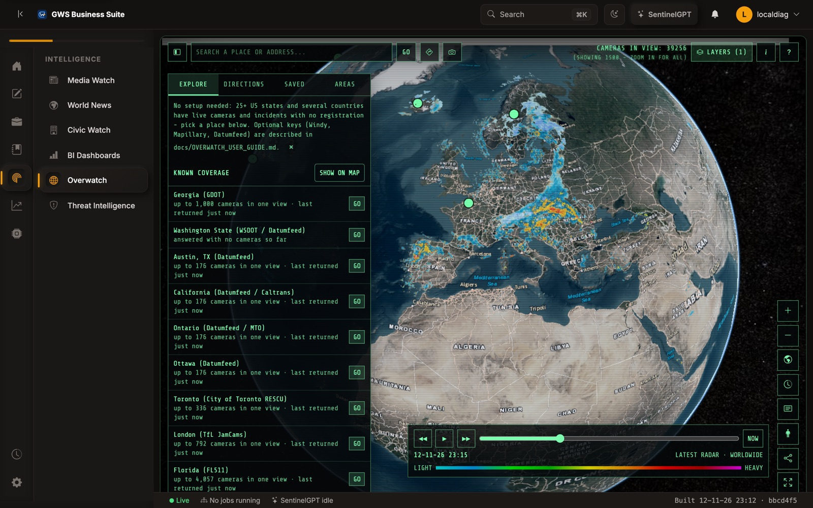
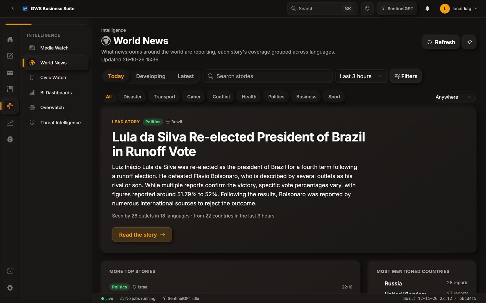
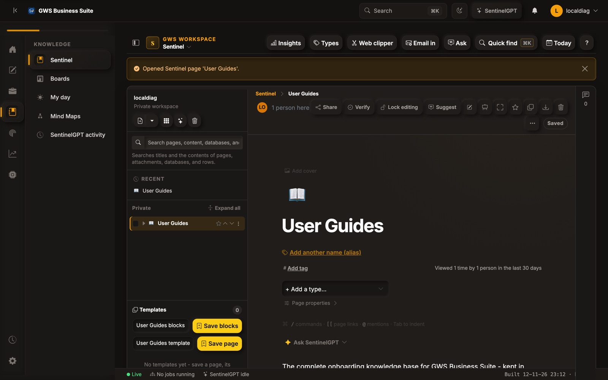
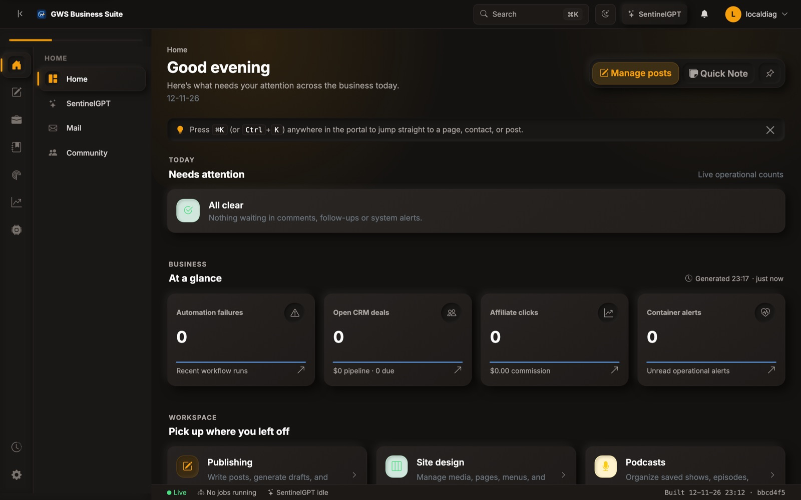
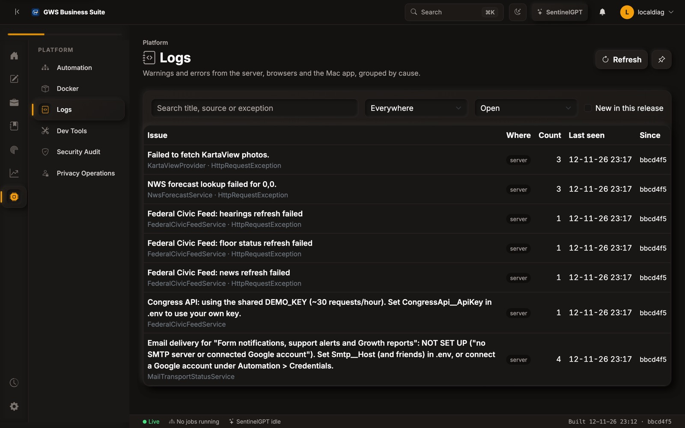
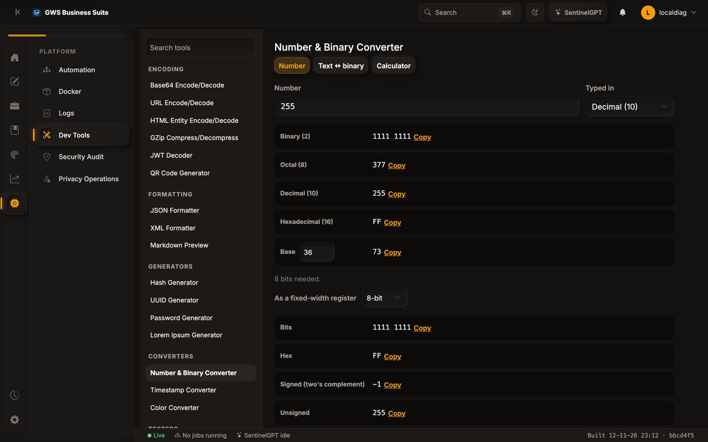

# GWS Business Suite

GWS Business Suite is one self-hosted application that runs a small business end to end: its
public website and publishing, its customers and money, its knowledge base, its intelligence and
monitoring, and the platform it all runs on. It is a Blazor Server web app with a native Mac app,
an installable phone and tablet app (PWA), and an on-device AI assistant, SentinelGPT.

It runs in Docker on a single server. AI work runs on the signed-in Mac through local
[Ollama](https://ollama.com) models, so the server needs no GPU and no paid AI service, and
most data sources are public and need no API key.

## Screenshots



| | |
| --- | --- |
|  |  |
| **World News** groups each story's coverage across outlets and languages. | **Sentinel**, each person's private workspace of pages, databases and boards. |
|  |  |
| **Home** shows what needs attention across the business. | **Logs** groups errors from the server, browsers and the Mac app by cause. |
|  | |
| **Dev Tools** includes a number, binary and text converter. | |

*Captured from a development copy on 12-11-26.*

## What it does

The admin side is organised into workspaces, each a rail icon with its own pages.

| Workspace | What's in it |
| --- | --- |
| **Home** | A dashboard of what needs attention, Mail (Gmail API or IMAP, with Gmail-style bulk actions and shortcuts), Community and shared boards. |
| **Content & Publishing** | A block-based page editor with draft/live publishing, posts and articles, Content Studio (AI drafting on the Mac), a content calendar, SEO audit, localisation, comments, the media library, site design and themes, form submissions, podcasts and Live Show (WebRTC broadcasting with a TURN relay). |
| **Relationships** | CRM with deal scoring, billing and invoices, time tracking, support tickets with SLAs, scheduling and bookings, email campaigns, user management and a client portal. |
| **Knowledge** | **Sentinel**, a Notion-style workspace: pages, databases with views, Kanban boards and sprints, whiteboards, templates, comments, version history, page locks with Touch ID or a PIN, daily notes, a web clipper, email-in and Notion import. Each person's Sentinel is private until they share it. Also My day and Mind Maps. |
| **Intelligence** | **Overwatch**, a 3D globe (CesiumJS on the web, MapKit in the Mac app) with live traffic cameras worldwide and layers for weather radar, alerts, traffic, aircraft, ships, satellites, conflict, hazards, fires, outages, travel advice and air quality. Also **World News** (stories clustered across about 80 outlets and languages), Media Watch, Civic Watch (government and local events), Business Intelligence dashboards and Threat Intelligence. |
| **Growth & Monetization** | Growth Studio analytics and reports, affiliate links and rotations, and CJ Ads commissions. |
| **Platform** | Workflow automation (a node-based builder with schedules and OAuth connections), Docker container management, **Logs** (errors from the server, browsers and the Mac app, grouped by cause, with traces), Dev Tools (encoders, formatters, generators and a number and binary converter), a tamper-evident security audit trail, and privacy operations (requests, retention and erasure). |

**SentinelGPT** is available on every admin page. It answers questions with citations from the
app's own data, and with your approval it acts through tools: pages, databases, boards, CRM and
automations. It uses only models running on your own Mac.

**The public site** (pages, articles, portfolio, forms and newsletters) is served by the same
app from the CMS.

## Clients

- **Web:** any modern browser. Admin pages adapt from phone to desktop.
- **Mac app** (`src/GwsBusinessSuite.App`, .NET MAUI on Mac Catalyst): the admin pages in a
  native window with a toolbar and menus, a native MapKit Overwatch, local Ollama models,
  on-device dictation and text recognition, and offline reading. Install or update it with
  `./scripts/install-gws-mac.sh` (or **Check for Updates** in the app).
- **Sentinel menu bar** (`src/GwsBusinessSuite.SentinelMenuBar`): a Mac menu-bar companion for
  quick notes and board cards.
- **Phones and tablets:** install the site as an app (PWA) for push notifications and
  passkey sign-in.
- **SentinelCLI** (`src/SentinelCLI`): a terminal coding agent on local Ollama models.

## Repository structure

| Project | Purpose |
| --- | --- |
| `src/GwsBusinessSuite.Domain` | Entities, value objects and business rules (no dependencies) |
| `src/GwsBusinessSuite.Application` | Use cases, service contracts, DTOs and validation |
| `src/GwsBusinessSuite.Infrastructure` | EF Core (SQLite), HTTP clients and external integrations |
| `src/GwsBusinessSuite.Web` | The Blazor Server app, API endpoints and public site |
| `src/GwsBusinessSuite.OllamaKit` | Shared Ollama client and model handling |
| `src/GwsBusinessSuite.SentinelAgentKit` | SentinelGPT's agent tools and prompts |
| `src/GwsBusinessSuite.WorldNewsKit` | World News clustering, analysis and coverage rules |
| `src/GwsBusinessSuite.App` | The Mac app (MAUI) |
| `src/GwsBusinessSuite.SentinelMenuBar` | The Mac menu-bar companion |
| `src/SentinelCLI` | The terminal coding agent |
| `tests/GwsBusinessSuite.Tests` | Unit, service and Playwright browser tests |

The code follows Clean Architecture, with dependencies pointing inward only:
`Web -> Application`, `Infrastructure -> Application + Domain`, `Application -> Domain`.
Components stay thin, and business logic lives in Application services.

## Getting started

Prerequisites: the .NET 10 SDK. The Mac app also needs the .NET MAUI workload and Xcode.

```bash
dotnet run --project src/GwsBusinessSuite.Web/GwsBusinessSuite.Web.csproj
```

The app creates its SQLite database and applies migrations on first start. Optional settings
(mail, push, cameras with keys, TURN) are listed in `.env.example`; everything else works
without configuration.

## Checking a change

```bash
./scripts/verify-release.sh
```

This runs the same gate as the deploy pipeline: it builds the server and shared projects, then
runs the full test suite, including Playwright browser tests. On a Mac it also builds the Mac
app when your branch touches it. It takes about 3 to 5 minutes. `--full` builds the whole
solution instead. A result of `PARTIAL` locally only means the deployed-site checks were not
run (pass `--base-url` to include them).

The native clients build separately, so server work never needs the MAUI workloads:

```bash
dotnet build src/GwsBusinessSuite.App/GwsBusinessSuite.App.csproj -f net10.0-maccatalyst
```

## Deployment

A push to `main` runs `.github/workflows/deploy.yml`. It runs the release gate and, if that
passes, builds the Docker image (tagged with the commit) on the server and restarts the
containers. Data, logs and backups live on a persistent Docker volume.

For Live Show viewers on restrictive networks, an optional coturn relay is included:

1. Point a DNS-only record (for example `turn.example.com`) at the host.
2. Copy the TURN settings from `.env.example` into the host's `.env` with a long random secret.
3. Allow TCP/UDP 3478 and UDP 49160-49200 in the firewall.
4. Deploy. The workflow adds `docker-compose.turn.yml` when the TURN variables are set.

## Database migrations

The DbContext lives in Infrastructure and the startup project is Web. These wrappers pass
both projects for you:

```bash
./scripts/add-migration.sh <MigrationName>
./scripts/remove-migration.sh
./scripts/update-database.sh   # optional: the app migrates on startup
```

Review generated files under `src/GwsBusinessSuite.Infrastructure/Migrations/` before committing.

## Contributing

`AGENTS.md` holds the working rules for this repository: shipping, conventions, known traps
and the production environment. Every assistant and contributor follows it. User guides are
kept outside the public repository.
